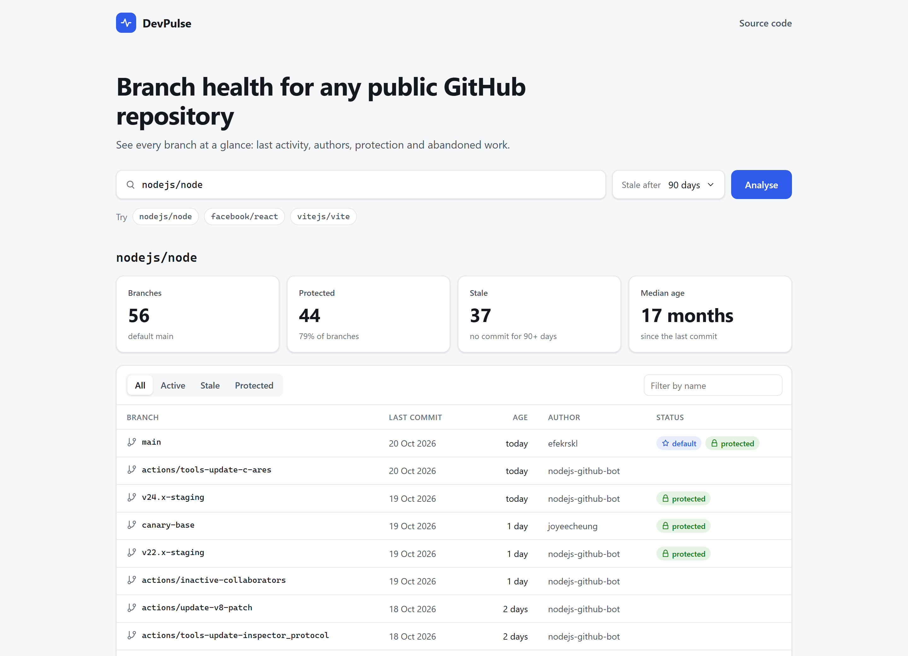
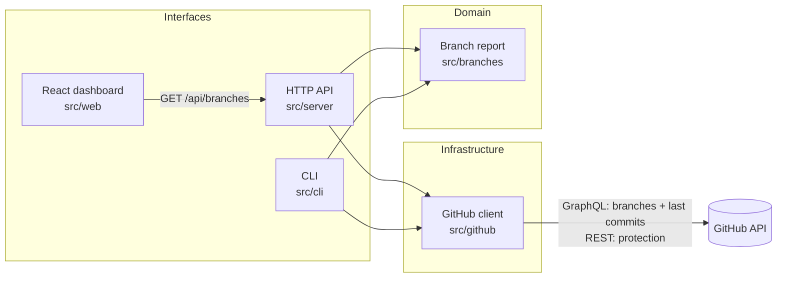
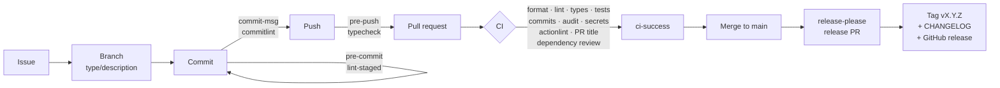

<div align="center">

# DevPulse

**Analytics for public GitHub repositories.**
Type a repository, see the health of every branch: activity, authors, protection and abandoned work.

[](https://github.com/BrahimNJ/DevPulse/actions/workflows/ci.yml)
[](https://www.conventionalcommits.org)
[](https://github.com/googleapis/release-please)
[](.github/dependabot.yml)

[](tsconfig.json)
[](src/web/)
[](vite.config.ts)
[](.nvmrc)
[](docs/ai/CLAUDE_CODE.md)

[Features](#features) · [Architecture](#architecture) · [Engineering practices](#engineering-practices) · [Run it locally](#run-it-locally) · [Roadmap](#roadmap)



</div>

---

## At a glance

DevPulse is a full-stack TypeScript project designed and built end to end, with a focus
on **production-grade engineering practices** rather than on volume of code:

- **Product:** a web dashboard and a command-line tool that analyse any public GitHub
  repository through the GitHub GraphQL and REST APIs.
- **Architecture:** layered code (domain, infrastructure, interfaces) with the business
  logic free of network, clock and framework, so every layer is tested in isolation.
- **Quality:** strict TypeScript, type-aware ESLint, 40+ deterministic unit tests, and
  one command, `npm run check`, that runs every gate locally exactly as CI does.
- **Delivery:** GitHub Actions pipeline, supply-chain hardening, semantic versioning and
  automated releases from Conventional Commits.
- **Decisions on record:** every technical choice is an
  [Architecture Decision Record](docs/decisions/) with the alternatives that were
  rejected and why.
- **AI-assisted development:** a versioned Claude Code setup with guard rails, scoped
  subagents and workflow skills, used throughout the project.

## Features

| Feature                 | Details                                                                                      |
| ----------------------- | -------------------------------------------------------------------------------------------- |
| **Branch overview**     | Every branch with its last commit date, author and age, most recently updated first          |
| **Health indicators**   | Totals for branches, protected branches and stale branches, plus the median branch age       |
| **Stale detection**     | Configurable threshold (30 to 365 days); the default branch is never flagged as abandoned    |
| **Accurate protection** | Classic protection rules _and_ rulesets, visible without admin rights                        |
| **Filters**             | All, active, stale or protected branches, and search by name                                 |
| **Shareable views**     | The URL holds the query, so `?repo=nodejs/node` reopens the same report                      |
| **Command line**        | The same report in a terminal, as an aligned table or as JSON for scripting                  |
| **Clear failures**      | Missing repository, invalid token, rate limits and network errors each get a precise message |

## Architecture



Design choices worth noting, each recorded in an ADR:

- **The domain knows nothing about I/O.** `src/branches` receives plain data and an
  injected date; the GitHub client receives an injected `fetch`. Tests never touch the
  network or the real clock.
- **One request per 100 branches.** GraphQL returns branches with their last commit in
  a single query, where REST would need one call per branch.
- **The token never reaches the browser.** The React app calls a local API; only the
  server, bound to `127.0.0.1`, holds `GITHUB_TOKEN`, and pagination links are only
  followed on the GitHub API origin.
- **A shared, typed contract.** The API response type is derived from the domain type,
  so the server and the React app cannot drift apart.
- **No build step for the back end.** Node.js 24 runs the TypeScript sources directly;
  Vite serves the React interface with hot reload in the same process.

| ADR                                                               | Decision                                                    |
| ----------------------------------------------------------------- | ----------------------------------------------------------- |
| [0002](docs/decisions/0002-adopt-typescript-node-and-npm.md)      | TypeScript, Node.js 24 and npm; quality tooling             |
| [0003](docs/decisions/0003-adopt-claude-code-workflow.md)         | Shared Claude Code configuration                            |
| [0004](docs/decisions/0004-release-and-local-deployment.md)       | Automated releases with release-please                      |
| [0005](docs/decisions/0005-command-line-application-and-tests.md) | Layered `src/`, native TypeScript, `node:test`, GitHub APIs |
| [0006](docs/decisions/0006-local-web-dashboard.md)                | Local web dashboard with React and Vite                     |

## Engineering practices

### Quality gates

| Gate                          | Local hook | CI  |
| ----------------------------- | ---------- | --- |
| Formatting (Prettier)         | pre-commit | ✅  |
| Linting (ESLint, type-aware)  | pre-commit | ✅  |
| Documentation (markdownlint)  | pre-commit | ✅  |
| Type checking (TypeScript)    | pre-push   | ✅  |
| Unit tests (node:test)        |            | ✅  |
| Commit messages (commitlint)  | commit-msg | ✅  |
| Pull request title            |            | ✅  |
| Secret scanning (gitleaks)    |            | ✅  |
| Dependency audit & signatures |            | ✅  |
| Dependency & licence review   |            | ✅  |
| Workflow linting (actionlint) |            | ✅  |

Every gate runs the same npm script locally and in CI, so a green `npm run check`
predicts a green pipeline.

### Delivery pipeline



- **Supply-chain security:** actions pinned to commit SHAs and images to digests,
  read-only default token, gitleaks, `npm audit` and signature verification, dependency
  and licence review, exact dependency versions.
- **Traceability:** every change goes from an issue to a branch, atomic Conventional
  Commits, a pull request with a template, and a release note.

### AI-assisted development

DevPulse ships a versioned [Claude Code](https://docs.claude.com/en/docs/claude-code/overview)
configuration, so every agent session starts with the same context, permissions and
guard rails.

| Component   | Purpose                                                                                                                    |
| ----------- | -------------------------------------------------------------------------------------------------------------------------- |
| `CLAUDE.md` | Lean session entry point: stack, commands, workflow; imports the agent rules instead of duplicating them                   |
| Permissions | Verification runs freely; pushes, PRs and installs ask first; force pushes, pushes to `main`, and `--no-verify` are denied |
| Hooks       | Block edits to secrets and generated files; auto-format every file the agent writes                                        |
| Subagents   | `repo-explorer` (Haiku), `code-reviewer`, `adr-writer`, `docs-writer`, `ci-doctor` (Sonnet), each with minimal tools       |
| Skills      | `/issue` → `/start-work` → `/check` → `/commit` → `/pr`, plus `/adr`                                                       |

Details in the [Claude Code guide](docs/ai/CLAUDE_CODE.md).

## Tech stack

| Concern            | Tools                                                                             |
| ------------------ | --------------------------------------------------------------------------------- |
| Language & runtime | TypeScript (strict), Node.js 24 LTS, npm                                          |
| Front end          | React 19, Vite 8, plain CSS with light and dark themes                            |
| Back end           | `node:http`, native `fetch`, GitHub GraphQL and REST APIs                         |
| Testing            | `node:test`, `node:assert`, injected fakes instead of network mocks               |
| Code quality       | ESLint with `typescript-eslint` strict type-checked rules, Prettier, markdownlint |
| Git workflow       | Conventional Commits, commitlint, husky, lint-staged                              |
| CI/CD              | GitHub Actions, release-please, actionlint                                        |
| Security           | Dependabot, gitleaks, dependency review, npm audit and signatures                 |
| AI tooling         | Claude Code subagents, skills, hooks, permission policies                         |

## Run it locally

**Prerequisites:** Git, Node.js 24 LTS, and a GitHub token. The
[GitHub CLI](https://cli.github.com) provides one with `gh auth token`.

```sh
git clone https://github.com/BrahimNJ/DevPulse.git
cd DevPulse
npm ci                                      # pinned dependencies and Git hooks
GITHUB_TOKEN=$(gh auth token) npm run web   # http://127.0.0.1:5173
```

Open <http://127.0.0.1:5173/?repo=nodejs/node> to see the dashboard above.

The same report in a terminal:

```sh
GITHUB_TOKEN=$(gh auth token) npm run devpulse -- branches nodejs/node
GITHUB_TOKEN=$(gh auth token) npm run devpulse -- branches nodejs/node --stale-days 180 --json
```

| Command             | Description                             |
| ------------------- | --------------------------------------- |
| `npm run web`       | Start the dashboard and its API locally |
| `npm run devpulse`  | Run the command-line tool               |
| `npm run check`     | Run every quality gate, tests included  |
| `npm test`          | Run the unit tests                      |
| `npm run typecheck` | Strict TypeScript check                 |

The full command reference is in [docs/DEVELOPMENT.md](docs/DEVELOPMENT.md).

## Project structure

```text
DevPulse/
├── src/
│   ├── branches/         Domain: branch report, input validation
│   ├── github/           Infrastructure: GitHub GraphQL and REST client
│   ├── cli/              Interface: command-line tool
│   ├── server/           Interface: local HTTP API, shared response contract
│   └── web/              Interface: React dashboard
├── docs/
│   ├── decisions/        Architecture Decision Records
│   ├── ai/               Claude Code usage guide
│   ├── ARCHITECTURE.md   Constraints and decision process
│   ├── DEVELOPMENT.md    Setup, commands, quality gates, CI/CD
│   └── GIT_WORKFLOW.md   From issue to release
├── .github/              CI/CD workflows, Dependabot, issue forms, PR template
├── .claude/              Claude Code settings, hooks, subagents, skills
├── AGENTS.md             Rules for AI coding agents
└── CONTRIBUTING.md       Branching, commits, pull requests, testing
```

## Roadmap

| Phase                     | Scope                                                                   | Status  |
| ------------------------- | ----------------------------------------------------------------------- | ------- |
| 1. Engineering foundation | Standards, toolchain, CI/CD, release automation, AI agent configuration | ✅ Done |
| 2. Branch statistics      | GitHub client, branch report, CLI, test runner (ADR 0005)               | ✅ Done |
| 3. Web dashboard          | React interface and local API (ADR 0006)                                | ✅ Done |
| 4. Performance            | Faster reports for repositories with thousands of branches              | Planned |
| 5. Repository analytics   | Further analyses, each specified in an issue before it is built         | Planned |

## Documentation

| Document                                         | Covers                                             |
| ------------------------------------------------ | -------------------------------------------------- |
| [CONTRIBUTING.md](CONTRIBUTING.md)               | Branch naming, Conventional Commits, PRs, testing  |
| [docs/GIT_WORKFLOW.md](docs/GIT_WORKFLOW.md)     | The full path from issue to release                |
| [docs/DEVELOPMENT.md](docs/DEVELOPMENT.md)       | Prerequisites, commands, gates, pipelines, secrets |
| [docs/ARCHITECTURE.md](docs/ARCHITECTURE.md)     | Architectural constraints and the decision process |
| [docs/ai/CLAUDE_CODE.md](docs/ai/CLAUDE_CODE.md) | Agents, skills, hooks, and token efficiency        |
| [SECURITY.md](SECURITY.md)                       | Private vulnerability reporting                    |

## Author

Designed and built by [@BrahimNJ](https://github.com/BrahimNJ). Feedback and questions
are welcome through [GitHub issues](https://github.com/BrahimNJ/DevPulse/issues).
