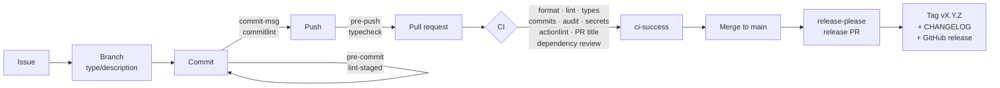

<div align="center">

# DevPulse

**A standards-first, AI-assisted engineering foundation.**
Every quality gate, pipeline, and agent workflow is in place and enforced before the first feature is written.

[](https://github.com/BrahimNJ/DevPulse/actions/workflows/ci.yml)
[](https://www.conventionalcommits.org)
[](https://github.com/googleapis/release-please)
[](.github/dependabot.yml)

[](tsconfig.json)
[](.nvmrc)
[](eslint.config.mjs)
[](.prettierrc.json)
[](docs/ai/CLAUDE_CODE.md)

[Highlights](#highlights) · [Tech stack](#tech-stack) · [Delivery pipeline](#delivery-pipeline) · [AI-assisted development](#ai-assisted-development) · [Quick start](#quick-start) · [Roadmap](#status-and-roadmap)

</div>

---

## Why DevPulse

Most projects add linting, CI, and conventions after the code exists, then fight the
backlog of violations. DevPulse inverts the order: the engineering system comes first,
so the first line of product code is already formatted, linted, type-checked, reviewed,
versioned, and released through an automated, auditable pipeline.

It is also a working reference for **AI-assisted development done with discipline**:
Claude Code runs inside explicit permissions, enforced hooks, and specialised
subagents, rather than as an unconstrained autocomplete.

## Highlights

| Area                        | What is in place                                                                                                                    |
| --------------------------- | ----------------------------------------------------------------------------------------------------------------------------------- |
| **Quality gates**           | Strict TypeScript, type-aware ESLint with complexity limits, Prettier, markdownlint; one command, `npm run check`, runs them all    |
| **Shift-left enforcement**  | Git hooks lint and format staged files, validate commit messages, and type-check before every push                                  |
| **CI pipeline**             | 8 parallel jobs aggregated into a single required `ci-success` check, plus PR title validation and dependency review                |
| **Supply-chain security**   | Actions pinned to commit SHAs, images to digests, read-only default token, gitleaks, npm audit and signature checks, licence policy |
| **Automated releases**      | Semantic versioning, changelog, tags, and GitHub releases generated from Conventional Commits by release-please                     |
| **AI agent engineering**    | Claude Code with shared permissions, guard-rail hooks, 5 scoped subagents, and 6 workflow skills, tuned for token efficiency        |
| **Architecture governance** | Every technical choice recorded as an Architecture Decision Record, with alternatives and consequences                              |

## Tech stack

| Concern            | Tools                                                                                                                                                                                                                                                                                                                                                                                      |
| ------------------ | ------------------------------------------------------------------------------------------------------------------------------------------------------------------------------------------------------------------------------------------------------------------------------------------------------------------------------------------------------------------------------------------ |
| Language & runtime |                                                                                                                         |
| Code quality       |     |
| Git workflow       |                                            |
| CI/CD              |                                                                                                                |
| Security           |                                                                                                                          |
| AI tooling         |  subagents, skills, hooks, permission policies                                                                                                                                                                                                                                               |
| Editor             |   recommended extensions, format on save                                                                                                                                                                                     |

The reasoning behind each choice, including the alternatives that were rejected, is in
[`docs/decisions/`](docs/decisions/).

## Delivery pipeline



### Quality gates

| Gate                          | Local hook | CI  |
| ----------------------------- | ---------- | --- |
| Formatting (Prettier)         | pre-commit | ✅  |
| Linting (ESLint, type-aware)  | pre-commit | ✅  |
| Documentation (markdownlint)  | pre-commit | ✅  |
| Type checking (TypeScript)    | pre-push   | ✅  |
| Commit messages (commitlint)  | commit-msg | ✅  |
| Pull request title            |            | ✅  |
| Secret scanning (gitleaks)    |            | ✅  |
| Dependency audit & signatures |            | ✅  |
| Dependency & licence review   |            | ✅  |
| Workflow linting (actionlint) |            | ✅  |

Every gate runs the same npm script locally and in CI, so a green `npm run check`
predicts a green pipeline.

## AI-assisted development

DevPulse ships a versioned [Claude Code](https://docs.claude.com/en/docs/claude-code/overview)
configuration, so every agent session starts with the same context, permissions, and
guard rails.

| Component   | Purpose                                                                                                                    |
| ----------- | -------------------------------------------------------------------------------------------------------------------------- |
| `CLAUDE.md` | Lean session entry point: stack, commands, workflow; imports the agent rules instead of duplicating them                   |
| Permissions | Verification runs freely; pushes, PRs and installs ask first; force pushes, pushes to `main`, and `--no-verify` are denied |
| Hooks       | Block edits to secrets and generated files; auto-format every file the agent writes                                        |
| Subagents   | `repo-explorer` (Haiku), `code-reviewer`, `adr-writer`, `docs-writer`, `ci-doctor` (Sonnet), each with minimal tools       |
| Skills      | `/issue` → `/start-work` → `/check` → `/commit` → `/pr`, plus `/adr`                                                       |

**Token efficiency by design:** cheap models for exploration, isolated subagent contexts
for wide searches, a single source of truth per rule, and hooks that remove formatting
round trips. Details in the [Claude Code guide](docs/ai/CLAUDE_CODE.md).

## Quick start

**Prerequisites:** Git and Node.js 24 LTS.

```sh
git clone https://github.com/BrahimNJ/DevPulse.git
cd DevPulse
npm ci          # installs pinned dependencies and activates the Git hooks
npm run check   # format, lint, Markdown, and type checks
```

| Command             | Description                                  |
| ------------------- | -------------------------------------------- |
| `npm run check`     | Run every quality gate                       |
| `npm run lint:fix`  | Fix ESLint findings automatically            |
| `npm run format`    | Format the repository with Prettier          |
| `npm run typecheck` | Strict TypeScript check, JavaScript included |

The full command reference is in [docs/DEVELOPMENT.md](docs/DEVELOPMENT.md).

## Project structure

```text
DevPulse/
├── .claude/              Claude Code settings, hooks, subagents, skills
├── .github/              CI/CD workflows, Dependabot, issue forms, PR template, CODEOWNERS
├── .husky/               Git hooks
├── docs/
│   ├── ai/               Claude Code usage and token-efficiency guide
│   ├── decisions/        Architecture Decision Records
│   ├── ARCHITECTURE.md   Constraints and decision process
│   ├── DEVELOPMENT.md    Setup, commands, quality gates, CI/CD
│   └── GIT_WORKFLOW.md   From issue to release
├── AGENTS.md             Rules for AI coding agents
├── CLAUDE.md             Claude Code entry point
├── CONTRIBUTING.md       Branching, commits, pull requests, code quality
└── SECURITY.md           Vulnerability reporting
```

## Status and roadmap

| Phase                     | Scope                                                                    | Status  |
| ------------------------- | ------------------------------------------------------------------------ | ------- |
| 1. Engineering foundation | Standards, toolchain, CI/CD, release automation, AI agent configuration  | ✅ Done |
| 2. Product definition     | Problem statement and first component, recorded as ADRs                  | Planned |
| 3. First component        | Application framework, test runner, local deployment with Docker Compose | Planned |

Planned items are decided through the [ADR process](docs/ARCHITECTURE.md#decision-records)
before any code is written.

## Documentation

| Document                                         | Covers                                             |
| ------------------------------------------------ | -------------------------------------------------- |
| [CONTRIBUTING.md](CONTRIBUTING.md)               | Branch naming, Conventional Commits, PRs, testing  |
| [docs/GIT_WORKFLOW.md](docs/GIT_WORKFLOW.md)     | The full path from issue to release                |
| [docs/DEVELOPMENT.md](docs/DEVELOPMENT.md)       | Prerequisites, commands, gates, pipelines, secrets |
| [docs/ARCHITECTURE.md](docs/ARCHITECTURE.md)     | Architectural constraints and the decision process |
| [docs/ai/CLAUDE_CODE.md](docs/ai/CLAUDE_CODE.md) | Agents, skills, hooks, and token efficiency        |
| [SECURITY.md](SECURITY.md)                       | Private vulnerability reporting                    |

## Author

Built and maintained by [@BrahimNJ](https://github.com/BrahimNJ).
